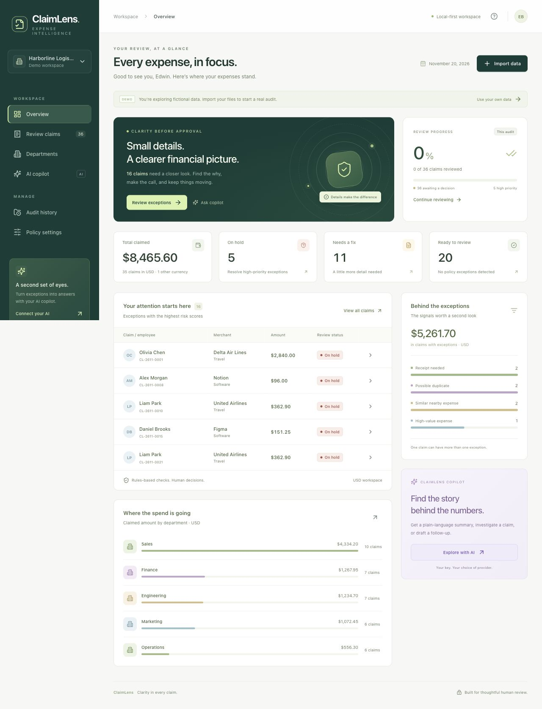

# ClaimLens

**Every expense, in focus.**

**Privacy:** ClaimLens starts empty. Import private records in your own browser, not in public GitHub. No fictional claims appear on startup.

ClaimLens is an expense review workspace that turns exports into an organized queue of policy exceptions, supporting evidence, and human decisions. It combines transparent checks with an optional AI copilot that uses your own provider API key.

[Open ClaimLens](https://claimlens-iota.vercel.app) · [Source repository](https://github.com/navybrown1/claimlens) · [AI setup and implementation details](docs/AI_SETUP.md)



## What you can do

- Import claims and employee rosters from **CSV, XLSX, or JSON**.
- Investigate possible duplicates within a batch and against a previous audit.
- Check receipt requirements, employee eligibility, category limits, submission dates, mileage, currencies, and restricted merchants.
- Search and filter claims, inspect the evidence behind each finding, record notes, and approve, reject, or request follow-up individually or in bulk.
- See department and category spending, exception counts, and review progress.
- Adjust the example policy and rerun the checks.
- Save up to **12 audit snapshots** in this browser and download portable JSON backups or spreadsheet-ready CSV reports.
- Use **OpenRouter, OpenAI, Anthropic, or Google Gemini** for summaries, questions, explanations, follow-up drafts, and receipt extraction.

The initial workspace has **zero sample claims and zero sample employees**. Import your own files; demo snapshots from previous versions are cleared when the app loads.

## Your first audit

1. Open **Import data** and download the claims and employee templates if needed.
2. Import the claims export and employee roster. Importing either into the demo clears the other demo dataset, so fictional employees cannot silently validate real claims. Either import order works.
3. Optionally load a previous ClaimLens JSON backup for duplicate comparison. Impossible expense dates are preserved for manual correction rather than dropped.
4. Open **Policy settings**, enter your organization's actual rules, and save.
5. Open **Review claims**. Read each finding, compare it with the source evidence, and record a decision or follow-up note.
6. Choose **Save audit**. In **Audit history**, download a JSON backup for a durable copy or export the review CSV from the claims view.

New claim imports replace the current session's claims and decisions. Policy, roster, and historical-comparison changes can invalidate earlier review decisions. Save a snapshot before replacing data you want to keep.

### Findings and decisions are separate

| Rule status         | Meaning                                                                                                                          |
| ------------------- | -------------------------------------------------------------------------------------------------------------------------------- |
| **On hold**         | At least one high-priority signal needs investigation, such as an unknown employee, a possible duplicate, or a high-value claim. |
| **Needs a fix**     | Additional information or policy review is needed, such as a receipt, business purpose, currency conversion, or date correction. |
| **Ready to review** | The record passed the configured checks. A person still reviews the evidence and decides.                                        |

Review decisions are **Pending review**, **Approved**, **Rejected**, or **Follow-up**. A rule result does not approve a claim automatically. The priority score is a simple, capped sum of rule severity points: high 65, medium 25, and low 10, with a maximum of 100. It is not a fraud probability.

## Example policy

The included values are editable product examples, **not verified organizational policy**. They are not legal requirements, tax advice, or an official reimbursement schedule.

| Setting                     | Initial value | How it is applied                                                         |
| --------------------------- | ------------- | ------------------------------------------------------------------------- |
| Base currency               | USD           | Dashboard spending totals include only this currency.                     |
| Receipt threshold           | 25.00         | A missing receipt is flagged at or above this amount.                     |
| Meal limit                  | 75.00         | Applied per claim; confirm whether multiple attendees are included.       |
| Accommodation limit         | 250.00        | Applied per claim, not per night; verify the number of nights.            |
| High-value review threshold | 2,500.00      | Higher amounts receive a high-priority review signal.                     |
| Mileage rate                | 0.70 per mile | Compares the amount with supplied mileage multiplied by this rate.        |
| Submission window           | 30 days       | Compares submission date with expense date.                               |
| Weekend review              | Off           | When enabled, Saturday and Sunday expenses receive a low-priority signal. |
| Business purpose            | Required      | Empty descriptions require follow-up.                                     |
| Restricted merchants        | Empty         | Optional case-insensitive substring matching against merchant names.      |

Restricted-merchant rules support up to **100 entries**, each at most **200 characters**. Choose distinctive merchant names: short fragments can match unrelated merchants.

Foreign-currency claims remain visible and receive a conversion-review finding. The app does not fetch exchange rates or combine different currencies into a single amount. Currency-based limits are skipped for foreign-currency claims until the source data is corrected or converted appropriately.

## Import contract

Each input file may contain up to **10 MiB** and **10,000 data rows**. Use `.csv`, `.json`, or `.xlsx`. Save older `.xls` files as XLSX or CSV first.

### Claims

| Field           | Required?          | Accepted value                                                                                                          |
| --------------- | ------------------ | ----------------------------------------------------------------------------------------------------------------------- |
| `id`            | Yes                | Unique claim ID, up to 120 characters. Duplicate IDs are rejected case-insensitively.                                   |
| `employeeId`    | Yes                | Employee identifier that matches the roster.                                                                            |
| `date`          | Yes                | Expense date as `YYYY-MM-DD` or `MM/DD/YYYY`.                                                                           |
| `amount`        | Yes                | Positive number with at most two decimal places. Common currency symbols and thousands separators are supported.        |
| `employeeName`  | No                 | Display name; a missing name can be resolved from the employee roster.                                                  |
| `department`    | No                 | Department; a missing value can be resolved from the roster.                                                            |
| `submittedDate` | Recommended        | Submission date. A missing or invalid value remains blank and is flagged.                                               |
| `merchant`      | Recommended        | Merchant name. Missing values are flagged.                                                                              |
| `category`      | Recommended        | Examples: Meals, Travel, Lodging, Software, Office supplies, Mileage.                                                   |
| `currency`      | Recommended        | Three-letter uppercase code. A missing value defaults to USD with an explicit warning.                                  |
| `receipt`       | Recommended        | `true`/`false`, `yes`/`no`, `1`/`0`, or supported receipt-status words. Missing values mean no receipt, with a warning. |
| `description`   | Recommended        | Business purpose, up to 5,000 characters.                                                                               |
| `mileage`       | For mileage claims | Positive distance in miles.                                                                                             |

Friendly headers such as `Claim ID`, `Employee Name`, `Expense Date`, `Vendor`, `Total Amount`, and `Business Purpose` are recognized automatically. Do not supply two headers or JSON properties that map to the same field, such as both `amount` and `total`.

JSON can be a row array or an object containing a `claims` array. Unknown fields are ignored. Duplicate IDs or ambiguous columns block the import. Other malformed rows are skipped with visible warnings while valid rows remain available. Review the import notes before relying on a partial import.

### Employee roster

Use `employeeId` or `id`, `name` or `employeeName`, `department`, `status`, and optional `manager`. Employee ID is required. If no name is supplied, the app displays the ID rather than inventing a name. Missing status is retained as **unknown** and flagged for eligibility review, never assumed active. Office, level, and cost center are retained. Duplicate employee IDs block the import.

### Excel behavior

Only the **first worksheet** is imported. It must have a header row and no more than 100 columns. Date cells and saved formula results are supported. Formulas are never executed, and a warning identifies the use of cached formula values. Recalculate the source workbook before exporting it.

## Connect your AI

The app's imports, rules, decisions, analytics, and backups work without an API key.

1. Open **AI copilot** and find **Your AI connection**.
2. Choose a provider and enter your developer API key. For OpenRouter, alternatively select the Vercel server-key option and enter a separate workspace access code.
3. Use a model available to your account. The model field is editable.
4. Select **Test connection**. This makes a small provider request and may consume credits.
5. Ask a question, use a suggested prompt, explain an individual claim, or extract a receipt.

Official setup guides: [OpenAI](https://developers.openai.com/api/docs/quickstart), [Anthropic](https://platform.claude.com/docs/en/api/overview), and [Google Gemini](https://aistudio.google.com/docs/api-key). See [AI_SETUP.md](docs/AI_SETUP.md) for request details, supported models, provider references, and troubleshooting.

**The API key exists only in the current tab's memory.** Refreshing or disconnecting clears it. ClaimLens does not save it to browser storage, audit exports, a database, or the repository. Requests pass through the app's server function to the selected provider; the application does not embed a shared provider key.

The copilot receives full-run counts and separate currency totals, plus up to **60 claims**, ordered by priority with a selected claim first. Employee names, original employee IDs, descriptions, reviewer notes, and decisions are excluded from the structured audit context. Chat also includes your question and up to six recent messages. Text you type can still contain personal information.

Receipt extraction accepts **PNG, JPEG, or WebP up to 2.5 MiB**. Clicking Extract receipt sends the complete image to the selected provider. The returned fields create a draft that you must review before adding it. Images are not stored in audit snapshots.

### OpenRouter server key and access control

To use an OpenRouter key already added in Vercel, configure two **Production secrets**: `OPENROUTER_API_KEY` for the provider key and `CLAIMLENS_ACCESS_TOKEN` for a separate, long random workspace access code. Redeploy after changing variables. In AI copilot select OpenRouter, enable the server-key option, and enter the workspace access code. Do not expose these secrets in source control.

This app has no built-in login, shared backend database, or role-based access. Protect the deployment if working with confidential employee records. Imports and ordinary policy checks run locally in your browser; AI actions send selected context to your provider only when requested. Snapshots remain local to that browser unless exported.

## Data and privacy boundaries

| Data or action                            | Where it goes                                                                 |
| ----------------------------------------- | ----------------------------------------------------------------------------- |
| Imported files and ordinary policy checks | Processed in the browser.                                                     |
| Unsaved claims, notes, and decisions      | Current page memory; refreshing does not preserve them.                       |
| Saved audit snapshots                     | Browser `localStorage` on this origin.                                        |
| CSV or JSON downloads                     | A file on the device, containing the exported audit data.                     |
| AI questions and selected context         | Through `/api/ai` to the chosen provider after an explicit AI action.         |
| Receipt image                             | To the chosen provider only when extraction is requested.                     |
| Provider key                              | Held in tab memory and transmitted for the requested server-to-provider call. |

Saved snapshots include claims, employees, policy, decisions, the available activity log, historical-comparison claims, and an explicit demo indicator. Backups are validated on import; malformed snapshots are not restored partially. Spreadsheet exports neutralize formula-like text in untrusted fields.

This is a **local review workspace**, without team sign-in, roles, shared database storage, encryption of browser snapshots, or an immutable compliance log. Anyone with access to the same browser profile may be able to access saved audits. Browser storage can be cleared or fill up; download backups for records you need to keep. Provider processing, retention, and billing remain governed by the provider account and settings.

The AI does not approve claims, make payments, send emails, browse the web, or execute instructions. Its answers can be wrong. Duplicate findings identify similar records to investigate; legitimate repeated purchases are possible. A receipt-present flag records that evidence exists, but the rules do not verify that evidence's authenticity.

## Run locally

The project was developed with **Node.js 24** and npm. Clone the repository, install the locked dependencies, and start the development server:

```sh
git clone https://github.com/navybrown1/claimlens.git
cd claimlens
npm ci
npm run dev
```

Open the localhost address printed by Vite. The development configuration also mounts `/api/ai`, so the optional AI connection works locally with your key. No provider environment variables or database are required.

```sh
npm test
npm run typecheck
npm run build
```

`npm run preview` serves the built frontend for inspection; it does not provide the AI function. Use `npm run dev` for a complete local app or a Vercel deployment for the production function.

## Architecture

| Area                     | Implementation                                                                                                                  |
| ------------------------ | ------------------------------------------------------------------------------------------------------------------------------- |
| App interface            | React + TypeScript, Vite, Lucide icons, responsive CSS.                                                                         |
| Policy engine            | `src/lib/audit.ts`: pure deterministic checks and priority scores.                                                              |
| Imports                  | `src/lib/imports.ts`: Papa Parse for CSV, lazy-loaded ExcelJS for XLSX, validated JSON.                                         |
| Demo                     | `src/lib/demo.ts`: fictional data dated relative to the current day.                                                            |
| Exports and history      | `src/lib/exports.ts`: templates, formula-safe CSV, validated portable snapshots.                                                |
| Local snapshots          | `src/lib/storage.ts`: validated browser storage with quota errors exposed to the UI.                                            |
| AI client                | `src/lib/ai.ts`: bounded context, provider configuration, request timeouts.                                                     |
| AI server                | `api/ai.ts`: same-origin JSON endpoint, fixed provider destinations, bounded inputs, safe errors, and validated receipt drafts. |
| Deployment configuration | `vercel.json`: Vite output, root API function, and HTTP security headers.                                                       |
| Automated checks         | `tests/`: policy, import, export, snapshot, and mocked provider-request coverage.                                               |

For Vercel, import this repository, use the Vite framework, build with `npm run build`, and serve `dist`. Keep the root `api/ai.ts` function enabled. Do not rewrite `/api/ai` to the SPA HTML. The configuration includes a 60-second function duration; see [Vercel function documentation](https://vercel.com/docs/functions/runtimes/node-js) for runtime details.

The test suite contains **95 checks** across the policy engine, import formats, history and exports, AI request handling, and interactive review workflows. GitHub Actions runs the production build, tests, and production dependency audit on pushes and pull requests.

Automated provider tests use mocked responses. They verify request construction, validation, and error behavior; they do not establish that a particular live API key has model access or sufficient credit. The in-app connection test provides that account-specific check.
